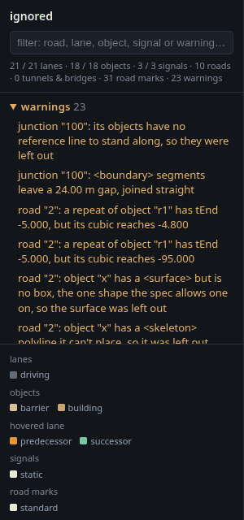

# xodr

[](https://github.com/jakeaboganda/xodr/actions/workflows/ci.yml?query=branch%3Amain)
[](https://github.com/jakeaboganda/xodr/blob/main/Cargo.toml)

A pure-Rust OpenDRIVE (`.xodr`) importer. It reads a map once and turns it
into lanes made of points, a lane graph in the direction traffic drives, and
a triangle mesh of the road surface. It also reads the OpenCRG (`.crg`)
files a map lays on its roads.

No C++ dependency, no bindings, no `unsafe`.

Up to 0.4.1 this crate was called `libopendrive`. It was renamed because
that name is easily confused with libOpenDRIVE, a C++ library.

```rust
use xodr::{load_file, Point};

let net = load_file("maps/town07.xodr")?;

// Where is the road under this point, and which way does it lean?
let sample = net.sample_near(Point::new(12.0, -30.0, 0.0)).expect("on the map");
println!("{:?} banked {} rad", sample.point, sample.bank);

// Where is that on its road, in OpenDRIVE's own s and t?
let at = net.road_position(sample.point).expect("on a road");
println!("road {} s {} t {}", net.road(at.road).unwrap().od_id(), at.s, at.t);

// Drive somewhere.
let waypoints = net.route(sample.point, Point::new(280.0, 95.0, 0.0));

// Hand the surface to a collider or a renderer.
let mesh = net.surface_mesh();
mesh.validate()?;
```

## What it builds

Each picture is a test map in the [viewer](viewer/README.md). Click one for
what the crate does there.

| | |
| --- | --- |
| [](docs/support.md#lane-layers) | [](docs/support.md#objects) |
| **Lane layers.** A road's temporary lanes, amber, sit over its permanent ones from where they start. Traffic queries prefer them. | **Object poses.** An object stands plumb on a banked road. With `perpToRoad="true"` it leans with the road instead, as the left post does. |
| [](docs/support.md#objects) | [](docs/support.md#objects) |
| **Skeletons.** A traffic light pole and its arm, from `<skeleton>` polylines with a radius at each vertex. | **Curved outlines.** Islands drawn with `<curveLocal>` lines, arcs and paramPoly3 curves. |
| [](docs/support.md#objects) | [](docs/support.md#objects) |
| **Areas inside an island.** Cobble and concrete inner outlines are areas of their own. The plain one is a hole. | **Paint.** A parking bay's lines, and a flat painted area with a hole in it. |
| [](docs/support.md#objects) | [](docs/support.md#opencrg-surfaces) |
| **Repeats.** Posts every few metres and continuous walls. Two run straight across the bend, detached from the road. | **Object surfaces.** The height an object's CRG adds to the road, inside its box, turned with it. |

The viewer also lists what it read and what it left out. Here it lists the
warnings of `tests/data/ignored.xodr`, a map that uses every feature the
crate ignores:



`docs/images/shots.py` takes these pictures again from the test maps.

## What it reads

- Road geometry, elevation, superelevation, lateral shape, cross-section
  surfaces, and the crossfall of OpenDRIVE 1.4.
- Lanes of every type, with their widths, borders, offsets, heights and
  sections, including sections that give one side of the road, and a
  road's temporary lane layer over its permanent one.
- Links and junctions, direct junctions included, as a lane graph, in
  right- or left-hand traffic, with reversed and two-way lanes.
- Junction groups, priorities, boundaries and cross paths, crossings and
  virtual junctions. A junction's roads stand on its elevation grid, and
  each road coming in blends into it.
- Road neighbors.
- Road types and speed limits along each lane, from the map's speed
  records, its speed limit signs and its default regulations.
- Lane rules, access, materials and visibility along each lane.
- Objects, standing upright or following the road, with repeats, outlines
  made of corners or curves, markings, borders, skeletons and surface CRGs,
  on roads and in junctions.
- Signals, with their meaning and boards, each sign on a board with its
  own lanes and links, the controllers that group them, and the message
  boards on one gantry.
- Road marks.
- Tunnels and bridges.
- Railway switches and stations.
- OpenCRG surfaces, for the height, normal and friction under a wheel.
- The geo reference: the PROJ string and offset, kept unapplied.
- The header, its licence, road and junction names, the `<userData>` and
  `<dataQuality>` on any element, and the other descriptive attributes of a
  map, kept for the caller.
- Included files, read in where an `<include>` names them.

It keeps each road. A caller can turn `(road, s, t)` or `(lane, s, offset)`
into a point on the road surface, turn a point back into a position, and move
a position along the lanes.

It loads a file whatever OpenDRIVE version it declares. If the file uses
something newer than that version, it still reads it, and warns that the
header is out of date. Where it drops part
of a bad file, it says so in `Provenance::warnings`. It also warns about each
feature it ignores, so a map that breaks no rule can still have warnings.
`Warning::is_ignored` tells those from faults.
[docs/support.md](docs/support.md) covers each element, and what it skips.

## Viewer

The crate draws nothing. [`viewer/`](viewer/README.md) has a three.js page
that runs the crate in the browser, compiled to WebAssembly. Open a `.xodr`
and hover a lane, object or signal to read what the crate knows about it.

```sh
sh viewer/run.sh
```

It builds the page, serves it on <http://localhost:8000> and opens it in
your browser. Click `open .xodr`.


It draws CRG heights as a heat map over the road. Here are ASAM's scanned
cobbles from `belgian_block.crg`, which `examples/crg_data.sh` downloads:


## OpenUSD

[`usd/`](usd/README.md) exports a map as an OpenUSD stage, with its lanes,
road marks, objects and signals. It's a separate tool, not part of the crate.

```sh
cargo run --release -p xodr-usd -- tests/data/town07.xodr
```

## How it fits together


## More

- [docs/design.md](docs/design.md): the coordinate frame, `Point` and
  `Vector`, mesh buffers, the `serde` feature, bad input, and timings. Lane
  lookups take about 0.4 us on CARLA's Town07.
- [docs/support.md](docs/support.md): what the importer does with each
  OpenDRIVE element.
- [docs/comparison.md](docs/comparison.md): each OpenDRIVE 1.9 element and
  attribute, and what this crate, esmini, libOpenDRIVE and CARLA do with
  it.
- [CHANGELOG.md](CHANGELOG.md)

The published crate leaves out the map fixtures, tests and benchmarks, so run
them from a git checkout. `tests/data/README.md` says where each fixture comes
from.

MSRV is 1.85.

## License

MIT or Apache-2.0, at your option.
