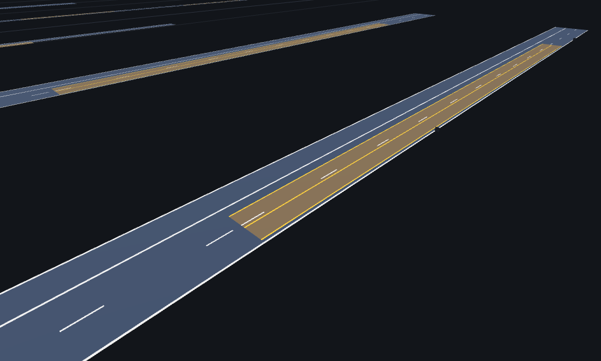
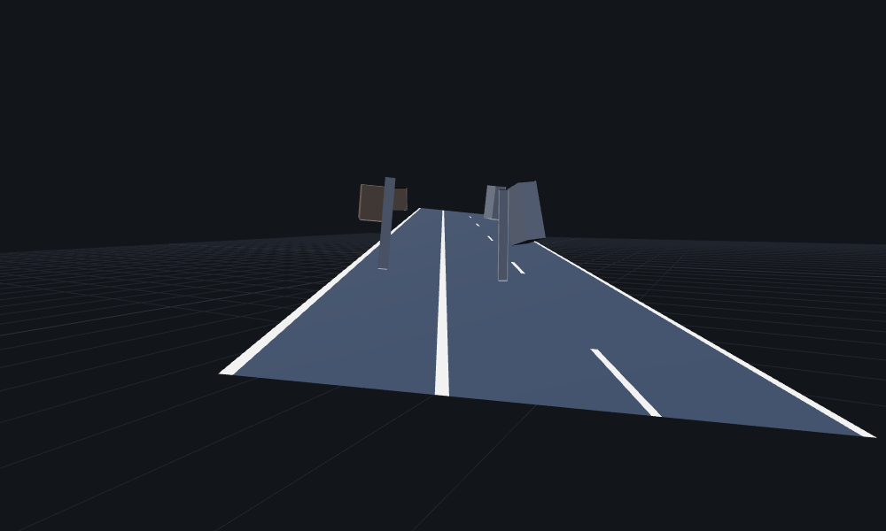
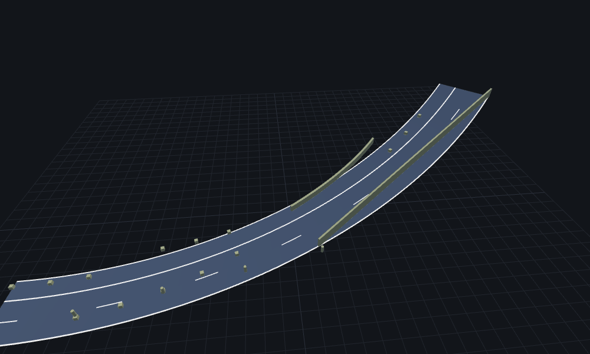
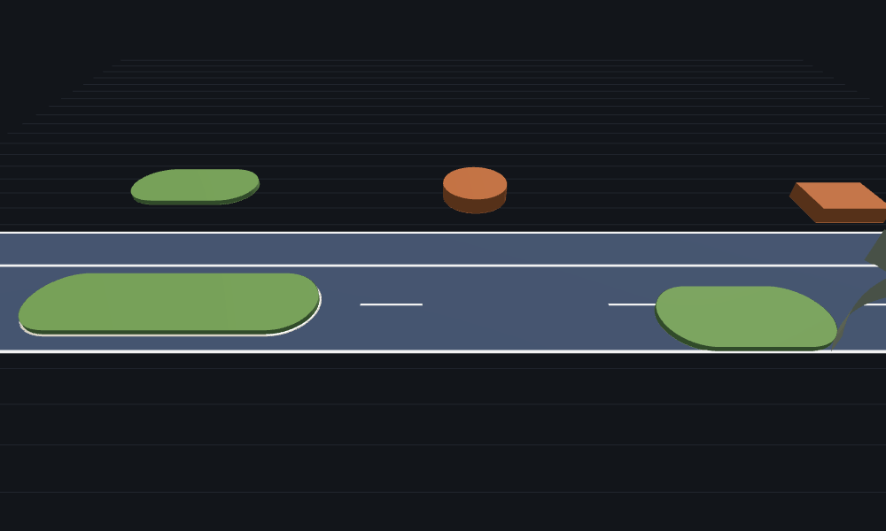
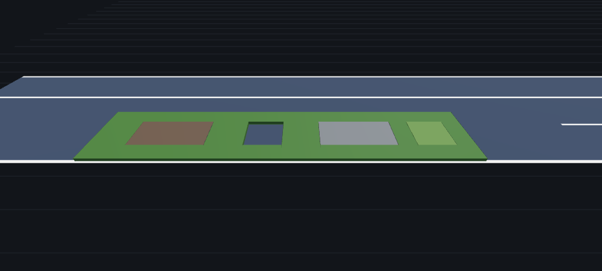
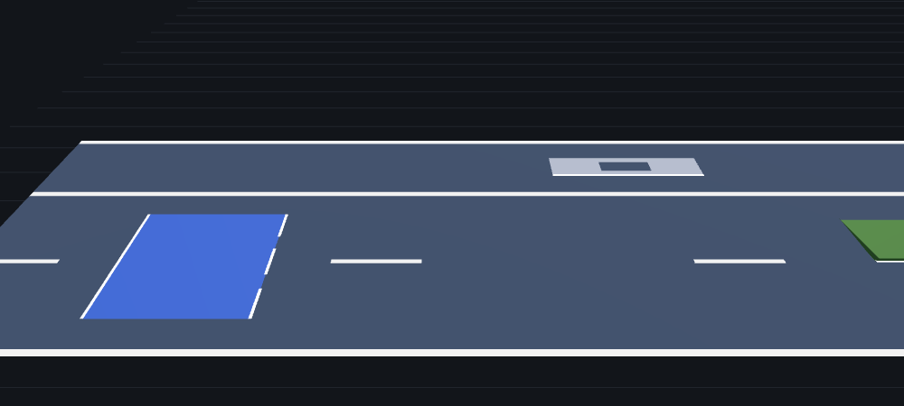
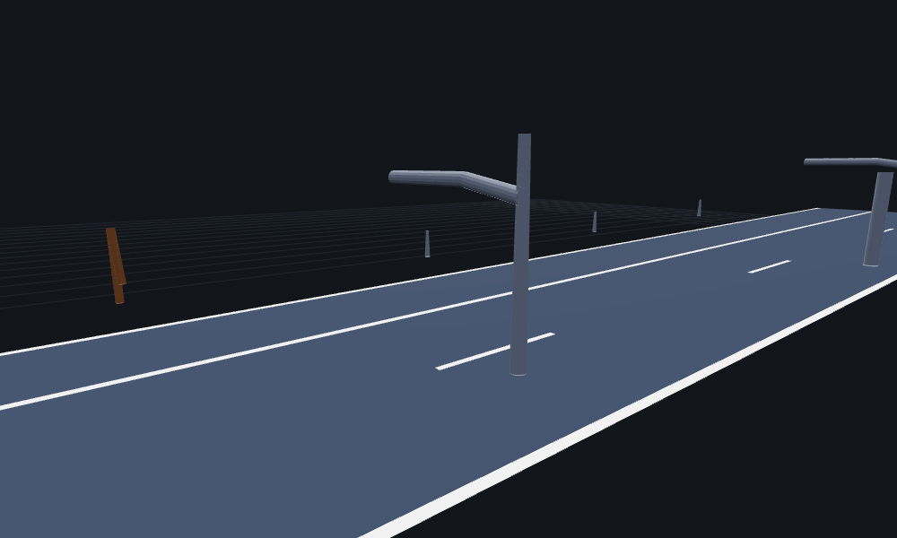
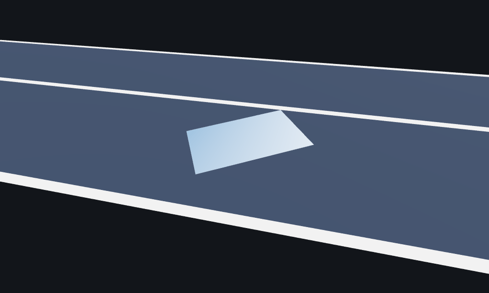

# OpenDRIVE support

What the importer reads from an `.xodr` file, and what it skips. For the exact
element and attribute list, see [the crate docs](https://docs.rs/xodr).

Geometry is cross-checked against the reference C++
[libOpenDRIVE](https://github.com/pageldev/libOpenDRIVE).
[comparison.md](comparison.md) sets each element and attribute beside what
esmini, libOpenDRIVE and CARLA do with it.

## Which OpenDRIVE version

The importer keeps a `<header>`'s attributes in `RoadNetwork::header` and its
geo reference in `RoadNetwork::geo_reference`. That includes `revMajor` and
`revMinor`, which it does not use to decide how to read the file. It never
rejects a file for its declared version. Whether a file loads depends only on
whether it uses the elements listed below.

Every element listed below is in ASAM OpenDRIVE 1.9.0, the current revision,
except a lane's `<visibility>` and a road's `<neighbor>`. 1.9 defines
neither. The importer reads them from the older files that write them:
`<visibility>` as CARLA does, and `<neighbor>` as libOpenDRIVE does.
1.9.0 deprecates `poly3` in favour of `paramPoly3`, and 1.8 deprecated a
signal's `<positionRoad>` and `<positionInertial>`. The importer reads them
like any other element and raises no warning. The test suite imports real
files declaring 1.4, 1.6 and 1.7.

## Roads and lanes

- Reference geometry: `line`, `arc`, `spiral` (clothoid), `paramPoly3`,
  `poly3`.
- `<elevationProfile>`, and `<lateralProfile>` superelevation, which tilts
  the road from side to side. The cross-section rolls about the reference
  line, so an outer lane
  rides higher and its surface normal leans.
- `<lateralProfile>` shapes, so a crowned road has its crown. Each lane
  border stands at the shape under it, and a lane goes straight across
  between its borders. So a curve inside a lane is lost: 5.5 mm at the
  middle of a 3.5 m lane on a crown falling 2.5 % at 7 m out. The first
  profile holds before it, where the spec gives 0. Objects, signals and
  road marks stand on the shape as the mesh has it.
- `<lateralProfile>` cross-section surfaces, baked as shapes are: strips
  of cubics across the road, each coefficient a cubic along it.
- Level lanes, `level="true"`, kept out of the superelevation and the
  shape. Each runs level from its inner neighbour's outer border.
- Per-lane widths, `laneOffset`, and multiple lane sections.
- The whole lane cross-section, the carriageway included. `LaneType` names
  every function the format defines, among them sidewalks, kerbs, ramps and
  tram track. An unrecognised name bakes as `LaneType::Unknown` rather than
  leaving a hole. `LaneType::is_drivable` separates the ones traffic uses.
- Lane widths that vary along a lane, so a gore area that opens out of a
  point is drawn as the wedge it is.
- Lane borders, which give a lane's outer edge as a `t` from the reference
  line rather than a width. A border lane stacks on the lane inside it, and
  width lanes stack on it. Where a lane has both, its widths win. A border
  ignores `laneOffset`, and one that crosses inside the lane within it
  gives its lane 0 width. The spec forbids all three, and each raises a
  warning.
- Lane heights, so a sidewalk stands above the road beside it. A lane's
  `<height>`s raise its centerline and tilt its surface, so the mesh and
  `Lane::sample_at` see the kerb. Poles, signs and road marks on a sidewalk
  stand on it. The step up to it is left open, as libOpenDRIVE and esmini
  leave it. `load_*_with_provenance` gives the heights at each centerline
  vertex.
- Road and lane `<link>`s and `<junction>`s, resolved into a lane graph in
  the direction traffic drives.
- A road's `rule`, so a left-hand-traffic road drives its left lanes along
  `+s`. A value other than `RHT` or `LHT` reads as `RHT` and raises a
  warning.
- A lane's `direction`: `reversed` runs it against its side, and `both`
  makes it a two-way lane, linked off both of its ends. A deprecated
  `type="bidirectional"` lane with no `direction` is two-way too. An
  unknown value reads as `standard` and raises a warning.
- A junction `<laneLink>`'s `overlapZone` is in
  `Provenance::lane_link_overlaps`. The crate uses none of it.
- Direct junctions, which join roads end to end through a `linkedRoad`.
  Each connection links both ways, as esmini reads it, unless the junction
  gives the way back itself.
- A road's `<neighbor>`s, from OpenDRIVE 1.4, as
  `RoadNetwork::road_neighbors`: the road beside it, and which way it runs.
- Junction `<boundary>`s and `<elevationGrid>`s, as
  `RoadNetwork::junction_areas`: the ring round a junction's ground, and
  the height of that ground, with a mesh of it. The junction's roads stand
  on the grid, as the spec says, their lane heights added to it, and a
  joint's `transitionLength` blends each road coming in into the grid.
- Railway `<switch>`es and `<station>`s, as `RoadNetwork::switches` and
  `RoadNetwork::stations`, each on the roads of its tracks. A switch keeps its
  partner's id and name.
- `<junctionGroup>`s, as `RoadNetwork::junction_groups`: the junctions the
  file groups as one, such as a roundabout's. The router does not use them.
- Virtual junctions, as `RoadNetwork::virtual_junctions`: roads meeting a
  main road part way along it, such as a driveway. The router does not
  follow those links.
- Junction `<crossPath>`s, as `RoadNetwork::cross_paths`: paths for
  pedestrians across the junction's roads, joining lanes part way along.
- Crossings, `<junction type="crossing">`, as `RoadNetwork::crossings`:
  where roads cross at one level without joining, with the stretch of each
  road from its `<roadSection>` and the lanes there.
- Junction `<priority>`s, as `RoadNetwork::priorities`: which road of a
  junction gives way to which.
- An incoming road whose `<link>` leaves out its common junction, which the
  spec forbids, links into it at the end its connecting road names, with a
  warning.
- Road types and speed limits, as stretches along each lane:
  `RoadNetwork::road_types` and `RoadNetwork::speed_limits`, in m/s. A
  lane's `<speed>` overrides its road's to the end of its lane section. A
  `<speed>` with no unit is in m/s. One the crate can't read raises a
  warning. Speed limit signs don't set a limit. A road type's `country`
  is in `RoadNetwork::road_countries`. The crate applies none of its rules.
- Lane `<rule>`s, `<access>`es and `<material>`s, as stretches along each
  lane: `RoadNetwork::lane_rules`, `lane_access` and `lane_materials`.
  Each holds to the next of its kind or the end of its lane section.
  Access is `Access::Allow` or `Access::Deny` with the road users the file
  names, in `<restriction>`s or the older `restriction` attribute. A deny
  of `none` lifts the restrictions before it.
- Lane `<visibility>`s, as stretches along each lane:
  `RoadNetwork::lane_visibility`. OpenDRIVE 1.9 does not define the
  element. The crate reads it as CARLA does, from older files. One with a
  distance the crate can't read raises a warning.

## Single-side lane sections

A `<laneSection singleSide="true">` gives the sides it has an element for.
The crate carries the other sides on from the sections before, and splits
the road into a full section at each one. A carried lane keeps its widths,
heights and marks as they stand where the new section starts, and links on
to its own copy. The spec does not say what the other sides do. A section
without `singleSide` gives every side.

## Lane layers

A road may have a temporary layer, such as for road works. It is a
`<lanes layer="temporary">` next to the permanent `<lanes>`. Each layer has
its own lane sections and `<laneOffset>`. `Lane::layer` says which a lane is
on. A lane section's index counts the permanent sections first. A temporary
section may give a `length`, and then ends there or at the next section of its
layer. A further `<lanes>` of one layer is left out, with an `Ignored`
warning. A road with only a temporary `<lanes>` bakes it as the permanent
layer.



- Both layers share the permanent layer's surface. `surface_mesh` and the
  road's heights are the permanent layer's. `temporary_mesh` has the
  temporary lanes, to draw over them, and is empty on a map with none. The
  crate does not clip a temporary lane that reaches past the permanent
  surface.
- A lane's `<link>` may name a lane on each layer, so traffic goes from the
  permanent layer onto the temporary one and back. A junction `<laneLink>`
  names its layers with `fromLayer` and `toLayer`.
- A `<validity layer>` picks the lanes of that layer, and one with no `layer`
  the permanent layer's. An object or signal with no `<validity>` applies to
  the lanes of both layers.
- Temporary lanes take precedence for driving. `nearest_lane`,
  `lane_position`, `route` and `advance` find a temporary lane where it holds
  the point. In `nearest_lane` only driving lanes take precedence. A
  temporary lane traffic may not use, such as a restricted one or one closed
  for works, hides the permanent lane under it, so `nearest_lane` finds the
  nearest lane that is not hidden. The lane graph, `route` and `advance` do
  not hide it.

To ask for the permanent layer alone, call the `_with` form of each query
with `LayerPolicy::PermanentOnly`. The default, `LayerPolicy::Both`, is what
the plain call does.

```rust
use xodr::{LayerPolicy, Point};

let at = Point::new(70.0, -2.75, 0.0);
let driving = net.nearest_lane(at);
let underneath = net.nearest_lane_with(at, LayerPolicy::PermanentOnly);
```

A link with no `layer` stays on the lane's own layer when that layer has a
next section, and otherwise goes to the permanent layer. The
[crate docs](https://docs.rs/xodr/latest/xodr/#lane-layers) list where it
departs from the spec.

## Road and lane positions

- `RoadNetwork::roads` keeps each road's reference line, profiles and lane
  sections. `road_point` turns a road `s` and `t` into the point on the
  surface there, and `road_position` turns a point back. Both include lane
  heights and the lateral shape. `road_lane` gives a lane's road, lane
  section and `<lane id>`.
- `road_position` takes the road whose surface is nearest in 3D, so a point
  on a bridge finds the bridge. Where roads overlap in a junction,
  `road_position` may return any of them. `road_position_on` takes the road
  to use.
- `lane_point` and `lane_position` do the same by lane: a road `s` and an
  offset from the lane's center, as esmini's `SetLanePos` takes them.
  `centerline_s` turns that road `s` into the distance along the lane's
  baked centerline, which `nearest_lane` and the speed limits use.
- `advance` moves a lane position along the lanes by a distance, and gives
  one place per branch. On a map with loops the branches grow exponentially
  with the distance, so step a few metres at a time. `left_of` and
  `right_of` step to the lane beside.
- `may_change_left` and `may_change_right` say whether the road mark on
  that border lets a vehicle cross into the lane beside, from its
  `laneChange`.

## Objects

`RoadNetwork::objects` has every `<object>`, in world coordinates on the road
surface. Each picture shows a test map from `tests/data/` in the viewer.

- A plain object is a box or a cylinder with a heading, pitch and roll. It
  stands upright: its pitch and roll are against the horizontal, as the schema
  says, so it stands level on a grade or a bank. With `perpToRoad="true"` it
  follows the road surface under its origin and ignores its pitch and roll.
  libOpenDRIVE places every object in the road's axes too, but turns it by its
  pitch and roll there. Figure 20 of the spec places objects in the road's
  tilted frame instead, and the crate follows the schema.

  
- A `<repeat>` with a `distance` becomes one object per step, so a row of
  posts arrives as posts. A `<repeat>` with a `distance` of 0, such as a guard
  rail, becomes one shape swept along the road. With a radius it is a round
  pipe.
- A `<repeat>`'s `t` runs straight from `tStart` to `tEnd`, or follows the
  cubic its `bT`, `cT` and `dT` give. With `detachFromReferenceLine="true"` it
  runs on the straight line between its two ends instead of along the road.

  
- An `<outline>`, in road or local coordinates, becomes a footprint polygon
  with a height at every corner. Its `<curveLocal>` arcs and paramPoly3 curves
  are cut into edges of about 25 cm. Under a `<repeat>` with a `distance`, the
  outline repeats at every step.

  
- An `outer="false"` outline is a hole cut out of the outline round it. With a
  `fillType` or a `laneType` it is also an area of its own, such as a cobbled
  path across a grass island.

  
- A closed outline with `fillType="paint"` is an area of paint. It lies flat,
  5 mm above its corners, with no height. The spec says a border round it cuts
  the area back, and the crate does not.
- A `<marking>`, such as a crosswalk's stripes, becomes painted quads along
  the outline edges it names, or along one side of the object's box if it
  names none. It is read inside an `<outline>`, as OpenDRIVE 1.9 writes it,
  and under the object, as earlier versions do. A `<border>`, such as a kerb,
  becomes a band along outline edges.

  
- A `<skeleton>` becomes polylines with a radius at each vertex, which the
  object mesh draws as frustums, mitred where a polyline bends, such as a pole
  and the arm it carries.

  
- An `<objectReference>` places the object it names again, at the reference's
  own station.
- A junction's `<objects>` stand along its `<planView>` reference line, at
  height 0 plus their `zOffset`, since the line has no elevation. Their
  provenance names the junction.
- `<validity>` picks the lanes an object applies to.
- `<parkingSpace>`, `<material>` and `<userData>` are kept on the object as
  data.

Each object has an id to look it up by, a subtype, and whether it moves.
`load_*_with_provenance` gives its road, OpenDRIVE id, `(s, t)`, orientation
and valid length. It also says whether the object is invalidated or temporary,
the `weight` of each marking, the `roadMarkColor` of each material, the
`fillType` and `laneType` of the outline it baked from, and the ids of its
skeleton's polylines and vertices.

## Tunnels and bridges

`RoadNetwork::structures` has each `<tunnel>` and `<bridge>` as the stretch of
each lane it covers. Call `structures_over(lane)` to find out whether a lane
runs through a tunnel or over a bridge, and where.

## Signals

`RoadNetwork::signals` has each `<signal>`: its catalogue codes, `value`,
`unit` and `text` as the file gives them, the lanes it applies to, and the
pose and size of its board.

- A board stands upright even on a banked road, and faces the traffic it
  addresses.
- A `<positionRoad>` or `<positionInertial>` moves the board, such as onto a
  gantry. The signal still applies where its `(s, t)` says.
- A signal applies to the lanes whose traffic runs the way its
  `orientation` names, so a reversed lane, a left-hand-traffic lane and a
  two-way lane get the right signals. A `<validity>` picks lanes by id
  instead.
- A `<signalReference>` applies the signal on another road too, adding the
  lanes there.
- `RoadNetwork::controllers` groups the signals that always show the same
  state, such as the lights of one approach. Each signal lists its
  controllers.
- A signal keeps its `<dependency>` and `<reference>` links as the ids of the
  signals and objects they name.
- `Signal::semantics` says what a signal means, from its `<semantics>`, and
  `Signal::boards` holds its `<staticBoard>`s and `<vmsBoard>`s, each sign
  and display area placed on the board. The crate applies no semantic. The
  provenance keeps a sign's own `id`, `countryRevision`, `orientation`,
  `dynamic`, `invalidated`, `temporary`, `hOffset`, `pitch`, `roll` and
  `length`. The crate places the sign by none of them. It wraps the three
  angles into one turn.
- `<vmsGroup>`s, as `RoadNetwork::vms_groups`: the variable message boards
  on one gantry, each by its signal.
- A sign's own `<validity>`, `<dependency>`s and `<reference>`s override
  its signal's, and so do a display area's validity and dependencies, which
  the spec's text gives it. A sign's dependency may name another sign on
  its board.

`load_*_with_provenance` gives its road, OpenDRIVE id, `(s, t)` and
orientation.

## Road marks

`RoadNetwork::road_marks` has the `<roadMark>`s on every lane border and the
center line. Each mark names the lanes either side of it, and keeps its type,
weight, colour, width, height and which way traffic may cross it. Its lines
are quads lying on the road surface.

- A mark's `<type><line>`s and `<explicit><line>`s are its lines, each with
  its own width, colour, dashes, offset and rule. Its `<sway>`s move them
  sideways.
- A mark without them gets stand-ins. A `solid` or `broken` mark paints one
  line and a double type two, with widths from libOpenDRIVE and dashes from
  esmini.
- A kerb, a grass edge and the other types that aren't paint keep their
  meaning and paint nothing.

The [crate docs](https://docs.rs/xodr/latest/xodr/#road-marks) list where it
departs from the spec, such as reading a mark without a colour.
`load_*_with_provenance` gives its road, lane section, lane
and stretch, and its `material` and its type's `name`.

## OpenCRG surfaces

The importer keeps `<surface><CRG>` records on roads and junctions, in all
four modes, and on objects, for elevation and friction. `RoadSurface` loads
the OpenCRG files they name and gives a vehicle model the height, normal and
friction under a point in `f64`. Off the CRG it answers from the surface mesh,
which the CRG does not change. Where several records of one purpose cover a
point, the last in the file wins. A junction's records win over its roads'.

An object's `<surface>` CRG adds to the height under it, inside the object's
box and in its own frame, turned by its heading. Unless it says
`hideRoadSurfaceCRG="false"`, it hides an `attached` road CRG there. The spec
turns the file with the object's pitch and roll too, and the crate does not.



The crate parses CRG files with [`opencrg`](https://crates.io/crates/opencrg)
and re-exports it, so `xodr::opencrg` also reads a `.crg` file on its
own.

```rust
use xodr::{load_file, opencrg::CrgGrid, RoadSurface, SurfaceHint};

let net = load_file("maps/track.xodr")?;
let mesh = net.surface_mesh();
let surface = RoadSurface::new(&net, &mesh, |file| {
    CrgGrid::from_path(format!("maps/{file}")).ok()
});
let mut wheel = SurfaceHint::default();
let ground = surface.sample(12.0, -30.0, &mut wheel);
```

Public maps that come with CRG files are hard to find, so
`examples/crg_to_xodr.rs` writes one for any CRG file: a road along the
file's reference line, with the file laid on it. `examples/crg_data.sh`
downloads five measured and test-course files from ASAM and Project Chrono,
and writes a map and a viewer scene for each. `examples/crg_profile.rs`
drives a wheel down a lane and writes what it rolls over as CSV.

```sh
sh examples/crg_data.sh
cargo run --release --example crg_profile -- target/crg/country_road.xodr > profile.csv
```

## Geo reference

- `RoadNetwork::geo_reference` keeps the `<geoReference>` PROJ string and
  the `<offset>` as the file gives them. The importer applies neither, so
  points stay in the file's frame.
- A missing or unreadable `<offset>` attribute reads as 0, as in esmini.
- The spec's offset takes the map's frame to the projected one. Some
  exporters, `netconvert` among them, write the opposite sign.

## Kept for the caller

The crate keeps some attributes it builds nothing from. It does not use them
to read the map, and it applies none of them. The crate docs have a section on
where each is. The header is in `RoadNetwork::header`, and a road's `name` in
`Road::name`. A junction's `name`, a road mark's `material` and its type's
`name`, a lane's `advisory` and flags, the center lane's attributes, an
object's outline `fillType` and `laneType`, its skeleton's polyline and vertex
ids, and a junction `<laneLink>`'s `overlapZone` are in the provenance. A road
type's `country` is in `RoadNetwork::road_countries`.

## Warnings

`Provenance::warnings` lists what a load dropped from a bad file, read from
a file that breaks a rule of the spec, or ignored. `Warning::road_id` gives
the road a warning happened on, or an empty string for one about a whole
junction or junction group. An `Ignored` warning has a `junction_id` as well,
and both ids are empty for a feature outside every road and junction.

A map that breaks no rule can still raise `Ignored` warnings, so an empty
list does not mean a clean map. `Warning::is_ignored` tells them from the
warnings for faults, as `warnings.iter().filter(|w| !w.is_ignored())` does.

| `Warning` | Raised for |
| --- | --- |
| `Ignored` | a feature the crate ignores, once for each road, junction, or the rest of the document, with a count. See [What it ignores](#what-the-importer-ignores) |
| `RoadSkipped` | a road with no finite `length`, one over 100 km, no `<planView>`, no geometry the importer can bake, lanes that land outside the range of an `f32`, or lanes that take the file past 2,000 km of lanes |
| `GeometryDropped` | a `<geometry>` missing its pose or `length`, with a `length` that isn't above 0 or is over 100 km, or of a shape the crate doesn't know |
| `RoadMarkLineDropped` | a road mark line with more dashes than the crate paints (100,000 on the line, or 1,000,000 in the whole file), or whose paint lands out of range |
| `TooManyCopies` | an `<object>` whose `<repeat>` or dashed `<marking>` would make over 100,000 copies or dashes, or whose copies would take the file's objects past what one load bakes |
| `JunctionObjectsDropped` | a junction's `<objects>` with no `<planView>` geometry to stand along |
| `ObjectSurfaceDropped` | an object's `<surface>` on an object with no box, such as a cylinder |
| `CrgHideIgnored` | an object's `<surface>` with `hideRoadSurfaceCRG` over a road CRG that replaces the road's height, which the spec forbids. The road CRG stays |
| `OutlineDropped` | an `<outline>` with a corner off the road or fewer than two corners, or an unfilled hole no closed outline encloses. An object left with nothing keeps its box |
| `SkeletonDropped` | a `<skeleton>` `<polyline>` with a vertex off the road or fewer than two vertices. An object left with nothing keeps its box |
| `CurveHeadingIgnored` | a `<curveLocal>` whose `hdg` leaves a gap that going on from the curve before closes. The crate goes on from the curve before |
| `OutlineGap` | an `<outline>` whose `<curveLocal>`s leave a gap over 1 cm. The crate joins it with a straight edge |
| `RepeatEndMismatch` | a `<repeat>` whose cubic `t` ends more than a millimetre from its `tEnd`. The crate follows the cubic |
| `LaneIdUnreadable` | a `<lane>` under `<left>` or `<right>` whose `id` isn't a whole number, or is 0 |
| `LaneDropped` | a lane with no `<width>` or `<border>` the crate can read |
| `WidthAndBorder` | a lane with `<border>`s in a lane section that also has `<width>`s |
| `BorderWithLaneOffset` | a border lane on a road whose `<laneOffset>` is not 0 |
| `BorderCrossesInnerLane` | a `<border>` inside the lane within it |
| `ShapeShortOfRoad` | a `<lateralProfile>` whose shapes start inside the road's edge |
| `CrossSectionWithShape` | a `<crossSectionSurface>` on a road that also has `<shape>`s or a `<superelevation>` |
| `StripDropped` | a cross-section `<strip>` with an `id` the spec doesn't allow, a repeated `id`, or no inner strip or `<width>` to place it by |
| `UnknownStripMode` | an outer `<strip>` whose `mode` is neither `independent` nor `relative` |
| `LaneNotLevel` | a lane outside a level lane that isn't level |
| `UnknownTrafficRule` | a road `rule` other than `RHT` or `LHT` |
| `UnknownLaneDirection` | a lane `direction` other than `standard`, `reversed` or `both` |
| `RoadLengthMismatch` | a road whose `length` isn't where its `<planView>` ends |
| `LinkGap` | a lane link between lanes more than 10 cm apart |
| `ConnectionDropped` | a junction `<connection>` without the roads it joins, or in a junction without an `id` |
| `LaneLinkDropped` | a junction `<laneLink>` whose `from` or `to` isn't a whole number |
| `JunctionLinkMissing` | an incoming road whose `<link>` leaves out its junction |
| `PriorityDropped` | a junction `<priority>` naming a road the load didn't bake |
| `JunctionReferenceDropped` | a `<junctionReference>` naming a junction the file lacks |
| `UnknownJunctionGroupType` | a `<junctionGroup>` with a missing `type` or one the spec doesn't allow |
| `RoadSectionDropped` | a crossing's `<roadSection>` naming a road the load didn't bake, or an end off it |
| `CrossPathDropped` | a `<crossPath>` naming a road, lane or `s` the load didn't bake |
| `BoundarySegmentDropped` | a junction `<boundary>` segment naming a road or lane the load didn't bake, or a station more than 1 cm off its road |
| `BoundaryNotClosed` | a junction `<boundary>` whose segments don't meet |
| `BoundaryClockwise` | a junction `<boundary>` that runs clockwise |
| `ElevationGridDropped` | a junction `<elevationGrid>` the crate can't place |
| `TransitionDropped` | a boundary `joint` with a `transitionLength`, in a junction with a grid, without a `lane` segment each side |
| `VirtualJunctionWithoutMainRoad` | a virtual junction without a `mainRoad` and stretch on a baked road |
| `VirtualLinkDropped` | a virtual junction link the crate can't place |
| `VirtualLaneDropped` | a lane pair of a virtual link that names a lane its road doesn't have there |
| `NeighborDropped` | a road `<neighbor>` the crate can't read |
| `RailwayDropped` | a railway `<switch>` or platform `<segment>` the crate can't place |
| `SpeedLimitDropped` | a `<speed>` whose `max` or `unit` the crate can't read, or whose limit is too large for an `f32` |
| `AccessDropped` | an `<access>` whose `rule` is neither `allow` nor `deny` |
| `VisibilityDropped` | a `<visibility>` with a distance the crate can't read |
| `ContactPointMissing` | a road `<predecessor>` or `<successor>` naming a road without a `contactPoint`. The crate joins that road's start |
| `RoadMarkDropped` | a `<roadMark>` at the same `sOffset` as the next on its lane, which replaces it. One at or past its section's end goes without a warning |
| `SignalDropped` | a `<signal>` without a readable `s` or `t`, or off the ends of its road |
| `SignalLinkDropped` | a signal's `<dependency>` or `<reference>`, a `<signalReference>` or a `<control>` naming a signal or object the load didn't bake, or a `<signalReference>` off its road |
| `CrgDropped` | a road or junction `<CRG>` without a `file`, a stretch on the road, a `mode` the crate knows (`global` for a junction's), or a `purpose` of `elevation` or `friction`, or a road one past the 2,000 km budget |
| `ObjectDropped` | an `<object>` without a readable `s` or `t`, or an `<objectReference>` without one or naming no object |
| `RepeatDropped` | a `<repeat>` without a readable `s`, `length` or `distance`, or with a negative one of the last two |
| `MarkingDropped` | an object `<marking>` without a width, naming fewer than two corners or a corner no outline has, or with a `side` the crate doesn't know |
| `StructureDropped` | a `<tunnel>` or `<bridge>` without a readable `s` or `length`, or with a negative `length` |
| `LaneSectionDropped` | a `<laneSection>` that starts past the end of its road. One under 1 mm long inside the road goes without a warning |
| `RecordDropped` | an `<elevation>`, `<superelevation>`, `<laneOffset>` or road `<type>` without a readable `s`, a `<shape>` without a readable `s` or `t`, or a lane `<width>` or `<border>` without a readable `a` |
| `RecordValueUnreadable` | a number of a profile record that isn't one, such as `b="NaN"`. The crate reads it as 0 |
| `RecordsOutOfOrder` | records of one kind, such as a lane's `<width>`s, that don't come in ascending order of where they start. The crate sorts them |

## What the importer ignores

The importer skips what the sections above do not list as read. Each feature
below raises an `Ignored` warning, once for each road, junction, or the rest
of the document, with how many times the file uses it.

Elements it skips: a header's `<license>` and
`<defaultRegulations>`, `<dataQuality>` and `<include>` anywhere. It skips
`<userData>` anywhere but directly on an object, which it reads.

Uses of elements it reads that it ignores:

| Feature | What the crate does |
| --- | --- |
| a second `<lanes>` of one layer | leaves it out |
| a `<roadSection>` of a junction that is not a crossing | leaves it out |

A first `<lanes>` of either layer raises nothing.

The importer reads a lane section's `<center>` for the road marks on the
center line, and for the lane's `id`, `type`, `level` and `<link>`, which are
in `Provenance::center_lanes`. Lane 0 never becomes a `Lane`, so the lane
graph does not follow its link.
